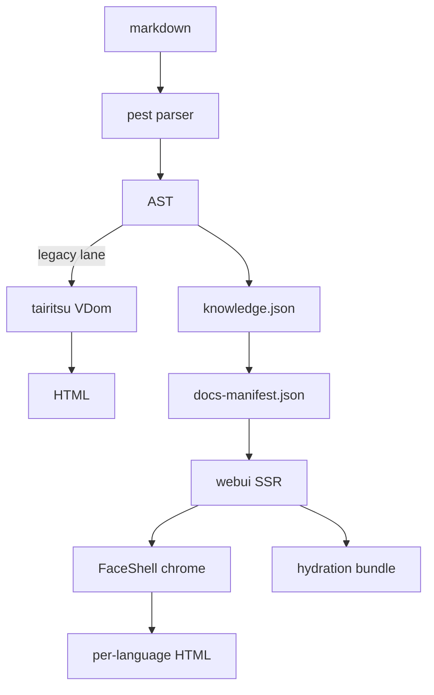

# Architecture

Lagrange is a single crate (`lagrange-library`) shipping a library and a
`lagrange` CLI.

## Pipeline

The docs tree ships through **two lanes**:

The **webui lane** runs when the build finds the webui bundle — from the
repo root (`packages/webui/dist-docs`), or anywhere via `LAGRANGE_WEBUI_DIR`;
`just docs` / CI build the bundles via pnpm first: every page renders through the real
hikari component tree — the same `HkFaceShell` / `HkAdminHeader` shell the
family's consoles wear, with the site logo in the brand slot, the language
and theme buttons in the top-right action area, and the SUMMARY sidebar
with rail collapse. The search is an inline field on desktop and one icon
button opening a bottom sheet below 768px; there is no footer band (a
static, account-free site has no status to report). Pages live at per-language
URLs (`<lang>/<path>.html`); the legacy flat URLs become language-negotiated
redirects. The **legacy lane** stays as the no-Node fallback.

## Modules

| Module | Responsibility |
|--------|----------------|
| `markdown` | pest grammar, AST, block + inline parser |
| `render` | AST -> tairitsu `VNode` -> HTML string |
| `theme` | CSS generated from the hikari palette |
| `site` | walks the docs tree, renders each page, writes a static site |
| `webui_lane` | docs-manifest.json emission + the Node SSR renderer spawn |
| `cli` | the `lagrange` binary |

## The closed loop

Lagrange renders its own documentation: `just docs` runs
`lagrange build docs`, and the CI workflow deploys the result. If you are
reading this on the published site, it was produced by Lagrange.

## Built on

- [tairitsu](https://github.com/celestia-island/tairitsu) — the virtual DOM
  used as the rendering IR.
- [hikari](https://github.com/celestia-island/hikari) — the colour palette used
  for theming.
- [pest](https://pest.rs) — the parser generator.
