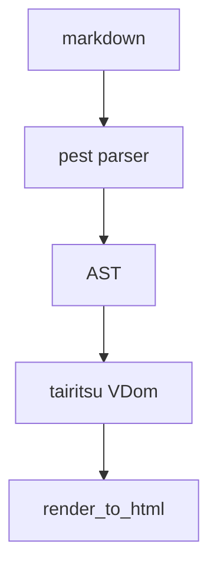

# Архитектура

Lagrange — это единый crate (`lagrange-library`), поставляющий библиотеку
и CLI `lagrange`.

## Конвейер

## Модули

| Модуль | Назначение |
|--------|----------------|
| `markdown` | грамматика pest, AST, блочный + строчный парсер |
| `render` | AST -> tairitsu `VNode` -> HTML-строка |
| `theme` | CSS, генерируемый из палитры hikari |
| `site` | обходит дерево docs, рендерит каждую страницу, пишет статический сайт |
| `cli` | бинарник `lagrange` |

## Замкнутый цикл

Lagrange рендерит собственную документацию: `just docs` запускает
`lagrange build docs`, а CI-воркфлоу развёртывает результат. Если вы читаете
это на опубликованном сайте, оно было создано Lagrange.

## Построено на

- [tairitsu](https://github.com/celestia-island/tairitsu) — виртуальный DOM,
  используемый как IR рендеринга.
- [hikari](https://github.com/celestia-island/hikari) — палитра цветов,
  используемая для темизации.
- [pest](https://pest.rs) — генератор парсеров.
